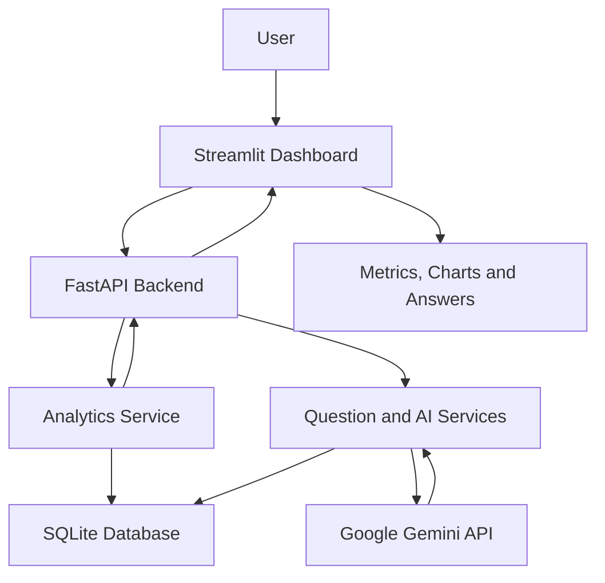

# Datrix — AI-Powered Business Intelligence Dashboard

Datrix is a business intelligence application that helps users explore sales data, understand revenue trends, compare business performance, and ask questions about their data using natural language.

The application combines a Streamlit dashboard, a FastAPI backend, SQLite storage, data-quality validation, and Google Gemini API integration.

## Features

- **Revenue analytics:** View total eligible revenue and key business metrics.
- **Monthly analysis:** Explore revenue trends across months.
- **Product analysis:** Compare revenue generated by different products.
- **Regional analysis:** Understand revenue distribution across regions.
- **AI Assistant:** Ask natural-language questions about business performance.
- **Data quality reporting:** Review records that are eligible for revenue calculations and records excluded or flagged by validation rules.
- **Automated API tests:** Test key endpoints and error-handling behavior.

## Technology Stack

| Component | Technology |
|---|---|
| Programming language | Python |
| Frontend | Streamlit |
| Backend API | FastAPI |
| Database | SQLite |
| Data processing | pandas |
| Visualizations | Plotly |
| AI integration | Google Gemini API |
| Testing | pytest |

## Architecture



The Streamlit frontend sends requests to the FastAPI backend. The backend uses analytics and question-processing services to retrieve and analyze sales data stored in SQLite. The AI service integrates with the Gemini API to interpret supported natural-language questions and generate responses grounded in the application's analytics.

## Project Structure

```text
buisness_ai_proj/
├── backend/
│   ├── __init__.py
│   ├── ai_service.py
│   ├── analytics.py
│   ├── api.py
│   ├── data_loader.py
│   ├── database.py
│   ├── llm_interpreter.py
│   └── question_service.py
├── data/
│   ├── sales_data.csv
│   └── data_quality_report.json
├── frontend/
│   └── app.py
├── tests/
│   └── test_api.py
├── .gitignore
├── requirements.txt
└── README.md
```

The database may be created automatically by the application, depending on the initialization flow in the code.

## Prerequisites

- Python 3.10 or a compatible Python version supported by the project's dependencies.
- Git.
- A Google Gemini API key for AI-powered question answering.
- A terminal or IDE such as Visual Studio Code.

## Installation

### 1. Clone the repository

```bash
git clone https://github.com/Sarayu005/datrix-business-intelligence.git
cd datrix-business-intelligence
```

### 2. Create a virtual environment

On Windows PowerShell:

```powershell
python -m venv .venv
.venv\Scripts\activate
```

### 3. Install dependencies

```powershell
python -m pip install --upgrade pip
pip install -r requirements.txt
```

### 4. Configure the Gemini API key

Create a `.env` file in the project root:

```env
GEMINI_API_KEY=your_gemini_api_key
```

Replace the placeholder with your own key.

**Security:** Never commit `.env` or expose your API key in source code, screenshots, or logs. The `.gitignore` file should exclude `.env`.

## Running the Application

Run the commands from the project root in separate terminal windows.

### 1. Start the backend

Activate the virtual environment, then run:

```powershell
python -m uvicorn backend.api:app --reload
```

The API will be available at:

- API base URL: `http://127.0.0.1:8000`
- Interactive API documentation: `http://127.0.0.1:8000/docs`
- Health check: `http://127.0.0.1:8000/health`

### 2. Start the frontend

In a second terminal, activate the same virtual environment and run:

```powershell
python -m streamlit run frontend/app.py
```

Open the local URL printed by Streamlit, usually `http://localhost:8501`.

## API Endpoints

| Endpoint | Purpose |
|---|---|
| `GET /` | Root endpoint |
| `GET /health` | Backend health check |
| `GET /analytics/revenue` | Total revenue analytics |
| `GET /analytics/top-product` | Highest-revenue product |
| `GET /analytics/monthly` | Monthly revenue analysis |
| `GET /analytics/top-region` | Highest-revenue region |
| `GET /analytics/compare` | Compare revenue for two months |
| `GET /analytics/products` | Revenue breakdown by product |
| `GET /analytics/regions` | Revenue breakdown by region |
| `GET /analytics/data-quality` | Data-quality report |
| `POST /ask` | Baseline question answering |
| `POST /ask-ai` | AI-assisted question answering |

For month comparisons, the API accepts `month_a` and `month_b` in `YYYY-MM` format.

See `/docs` for the actual request schemas and response formats.

## Data Quality and Revenue Calculation

The application validates sales records before including them in revenue calculations. Eligibility rules include checks such as transaction status, positive quantity and unit price, valid discounts, usable dates, product information, and transaction ID uniqueness.

The intention is to prevent invalid or unsuitable records from incorrectly affecting reported revenue while retaining information needed for data-quality reporting.

The exact revenue basis and exclusion counts are available through the application's analytics and data-quality reporting endpoints.

## Running Automated Tests

Run the tests from the project root:

```powershell
python -m pytest -v
```

The API test suite covers key functionality such as the health endpoint, revenue analytics, product analytics, month comparisons, and selected invalid or unsupported requests.

Test results should be verified in the current environment before reporting a passing test count.

## AI Integration

The application uses the Google Gemini API to interpret supported natural-language business questions. The interpreted intent and parameters are used to select the relevant analytics operation.

The application then returns an answer and, where available, supporting evidence or chart data. The analytics calculations are handled by the backend rather than relying solely on the language model to calculate business metrics.

AI development assistance was also used during implementation to explore approaches, troubleshoot errors, and understand programming concepts. Generated suggestions were reviewed and tested during development.

## Limitations and Future Improvements

Potential areas for improvement include:

- Expanding automated unit and integration test coverage.
- Improving handling of AI API failures, timeouts, and malformed responses.
- Supporting more natural-language question types.
- Adding stronger validation for unusual or incomplete input data.
- Improving logging, monitoring, and deployment configuration.
- Adding additional dashboard filters and performance optimizations where needed.

## Author

**Sarayu**

This project was developed as a business intelligence application demonstrating backend API development, database operations, data validation, analytics visualization, AI integration, and automated testing.
